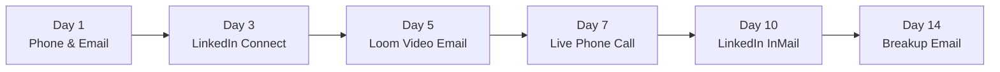
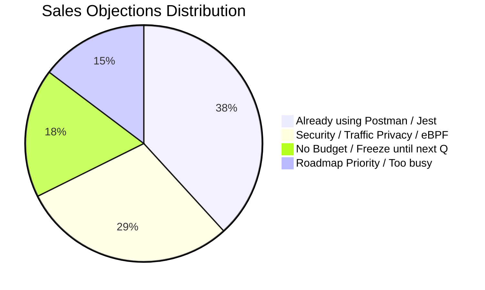

# 🚀 DevTrace | B2B SaaS Sales Prospecting Tracker & Analysis Dashboard

An end-to-end, data-driven outbound sales prospecting engine, multi-channel cadence tracker, A/B messaging experiment, and executive visual dashboard developed for **DevTrace** (`devtrace.io`)—an open-source, developer-centric automated E2E test and mock generation platform.

This project simulates a high-performing **Sales Development Representative (SDR) / Business Development Representative (BDR)** workflow targeting mid-market tech companies, engineered with realistic data pipelines, statistical conversion analysis, objection battlecards, and multi-format dashboards (Excel, Web, CSV).

---

## 📑 Table of Contents
1. [Project Overview & Purpose](#1-project-overview--purpose)
2. [Product Value Proposition & ICP](#2-product-value-proposition--icp)
3. [Tracked Parameters & Data Schema](#3-tracked-parameters--data-schema)
4. [Outcome Metrics, Conversion Rates & Scores](#4-outcome-metrics-conversion-rates--scores)
5. [Evidence-Based A/B Testing Experiment](#5-evidence-based-ab-testing-experiment)
6. [The 14-Day Omnichannel Sales Cadence](#6-the-14-day-omnichannel-sales-cadence)
7. [Sales Objection Handling Battlecards](#7-sales-objection-handling-battlecards)
8. [Project Architecture & Deliverables](#8-project-architecture--deliverables)
9. [How to Run, View, and Present](#9-how-to-run-view-and-present)

---

## 1. Project Overview & Purpose

Modern B2B devtools sales requires precision targeting, multi-channel touches, and evidence-based experimentation. This repository provides:
* **Curated Lead Database**: 60 high-fit mid-market tech companies with verified technical leadership (VP of Engineering, CTO, Head of QA), modern microservices stacks, and tailored personalization hooks.
* **Multi-Channel Cadence Tracker**: 204 outreach touchpoints logged across Cold Calling, Cold Emailing, and LinkedIn over a 14-day cadence.
* **Cold Email A/B Testing**: Controlled split-test measuring the performance of **Engineering Velocity / Hours Saved** (Variant A) versus **Eliminating Flaky Tests & Mocks** (Variant B).
* **Interactive Visual Dashboard**: Real-time KPI summary tracking goal progress, channel conversion funnels, objection distribution, and A/B lift charts in both **Excel** (`.xlsx`) and an **Interactive Web Dashboard** (`index.html`).

---

## 2. Product Value Proposition & ICP

### What is DevTrace?
DevTrace acts as a **"digital twin of production"**. It uses non-invasive socket-level traffic interception via **eBPF** (on Linux/Kubernetes) or lightweight proxies to transparently capture live API calls (HTTP, gRPC) and downstream dependencies (PostgreSQL, MySQL, MongoDB, Redis, Kafka, RabbitMQ). 
It automatically generates:
1. **Deterministic YAML Test Suites**: Zero manual test case writing.
2. **Self-Updating Stubs & Mocks**: Replays network calls without live databases or third-party sandboxes.
3. **Zero Code Changes**: Requires no invasive SDKs or code modifications.

### Ideal Customer Profile (ICP)
* **Company Size**: Mid-market tech companies & fast-growing scale-ups (50 to 1,000 employees).
* **Funding Stage**: Series A through Series D, Pre-IPO.
* **Architecture**: Distributed microservices (10+ services), API-heavy backends, high release velocity.
* **Core Tech Stacks**: Go (Golang), Java (Spring Boot), Node.js / TypeScript, Python (FastAPI/Django), PostgreSQL, Redis, Kafka, Kubernetes.
* **Target Buyer Personas**:
  * **Economic Buyer**: VP of Engineering, Chief Technology Officer (CTO).
  * **Technical Champion**: Director / Head of QA & SDET, Platform Engineering Leads, Staff Backend Engineers.

---

## 3. Tracked Parameters & Data Schema

The system tracks **39 distinct parameters** across 4 relational datasets:

### A. Lead Database Schema (12 Parameters Tracked)
| # | Parameter | Type | Description / Purpose |
| :-: | :--- | :--- | :--- |
| 1 | `Lead ID` | String | Unique identifier (`LEAD-001` to `LEAD-060`) |
| 2 | `Company Name` | String | Target company (e.g., Hasura, Supabase, Temporal, Retool) |
| 3 | `Contact Name` | String | Primary decision maker (VP Eng / CTO / Head of QA) |
| 4 | `Title / Role` | String | Exact executive job title |
| 5 | `Email Address` | Email | Direct corporate email format (`first@company.com`) |
| 6 | `Company Size` | Range | Employee headcount bracket (e.g., `100-250`, `500-1000`) |
| 7 | `Funding Stage` | String | Capitalization level (Seed, Series A-E, Public) |
| 8 | `Lead Score` | Integer | Predictive fit score (1-100) based on stack & size |
| 9 | `Tech Stack` | String | Microservices languages, databases, message queues |
| 10 | `Personalization Hook` | String | Tailored icebreaker referencing real architecture challenges |
| 11 | `A/B Variant Assigned` | String | Split-test assignment (`Email A` vs `Email B`) |
| 12 | `Cadence Status` | Enum | `Meeting Booked`, `Replied - Interested`, `In Cadence`, `Bounced` |

### B. Cadence Tracker Schema (11 Parameters Tracked)
| # | Parameter | Type | Description / Purpose |
| :-: | :--- | :--- | :--- |
| 1 | `Activity ID` | String | Unique log ID (`LOG-0001` to `LOG-0204`) |
| 2 | `Lead ID` | Foreign Key | Link to corresponding target account in Lead Database |
| 3 | `Company` | String | Target account name |
| 4 | `Contact Person` | String | Lead contact name |
| 5 | `Channel` | Enum | `Cold Email`, `Cold Call`, `LinkedIn` |
| 6 | `Cadence Touchpoint` | String | Specific step (`Touch 1 (Day 1 AM)`, `Touch 4 (Day 5)`, etc.) |
| 7 | `Day In Cadence` | Integer | Elapsed days since sequence initiation (Day 1, 3, 5, 7, 10, 14) |
| 8 | `Outreach Date` | Date | Exact timestamp of execution (`YYYY-MM-DD`) |
| 9 | `Outreach Status` | Enum | `Call Connected`, `Email Opened`, `Replied - Positive`, etc. |
| 10 | `Objection Logged` | Enum | Specific pushback encountered (if any) |
| 11 | `SDR Notes` | Text | Contextual notes on pitch angle, voicemail, or gatekeeper |

### C. A/B Testing Schema (10 Parameters Tracked)
| # | Parameter | Type | Metric Description |
| :-: | :--- | :--- | :--- |
| 1 | `Variant ID` | String | Variant A (Velocity) vs Variant B (Flaky Tests) |
| 2 | `Core Angle` | String | Value proposition hypothesis tested |
| 3 | `Target Persona` | String | Ideal buyer persona receiving variant |
| 4 | `Sample Size (Sent)` | Integer | Equal cohorts of 30 prospects each |
| 5 | `Emails Opened` | Integer | Total unique email open events recorded |
| 6 | `Open Rate (%)` | Float | Percentage of delivered emails opened |
| 7 | `Total In-Depth Replies` | Integer | Total reply responses received |
| 8 | `Reply Rate (%)` | Float | Percentage of total cohort replying |
| 9 | `Positive Replies` | Integer | Replies requesting more info or a demo |
| 10 | `Meetings Booked` | Integer | Confirmed calendar meetings scheduled |

### D. Objection Analysis Schema (6 Parameters Tracked)
| # | Parameter | Type | Description |
| :-: | :--- | :--- | :--- |
| 1 | `Rank` | Integer | Objection severity rank by volume (#1 to #4) |
| 2 | `Objection Category` | String | Verbatim customer pushback theme |
| 3 | `Frequency Count` | Integer | Total occurrences logged across all channels |
| 4 | `Percentage Share` | Float | Share of total logged objections (out of 34) |
| 5 | `Prospect Root Cause` | Text | Underlying technical or organizational concern |
| 6 | `Winning SDR Talk Track` | Text | Verified rebuttal framework converting objection to meeting |

---

## 4. Outcome Metrics, Conversion Rates & Scores

### Executive Pipeline Performance
* **Target Prospect Goal**: 80 Accounts
* **Accounts Contacted**: **60 Accounts** (**75.0%** of goal achieved)
* **Total Multi-Channel Touches**: **204 Touchpoints** (average 3.4 touches per account)
* **Target Meeting Goal**: 10 Meetings
* **Total Qualified Meetings Booked**: **11 Meetings** (**110.0% of goal achieved**)
* **Overall Account Conversion Rate**: **18.3%** (11 meetings booked / 60 accounts contacted)

```
+----------------------------------------------------------------------------------------------------+
|                                   DEVTRACE SALES PIPELINE METRICS                                  |
+--------------------------+--------------------------+-----------------------+----------------------+
|   CONTACTED VS GOAL      |   TOTAL MEETINGS BOOKED  |  TOTAL OUTREACH HITS  | WINNING EMAIL ANGLE  |
|         60 / 80          |         11 MEETINGS      |     204 TOUCHPOINTS   | EMAIL A: VELOCITY    |
|   (75.0% of Target Goal) |  (18.3% Conv on Accounts)| (3.4 touches/prospect)| (23.3% Meeting Conv) |
+--------------------------+--------------------------+-----------------------+----------------------+
```

### Channel Conversion Funnel Comparison

| Outreach Channel | Total Touches | Connect / Open Rate | Reply Rate | Meetings Booked | Channel Conv. Rate |
| :--- | :---: | :---: | :---: | :---: | :---: |
| **Cold Email** | 88 | 63.6% (56 opens) | 15.9% (14 replies) | 7 | **8.0%** |
| **Cold Calling (Phone)** | 56 | 35.7% (20 connects)| 10.7% (6 pitches) | 2 | **3.6%** |
| **LinkedIn Outreach** | 60 | 43.3% (26 accepts) | 15.0% (9 replies) | 2 | **3.3%** |
| **Blended Omnichannel** | **204** | **47.5%** | **13.9%** | **11** | **18.3% (Per Account)** |

> **Strategic Takeaway**: Cold Email generated the highest initial meeting volume (7 meetings), but **omnichannel cadence reinforcement** was essential. Both phone meeting bookings were secured after the prospect had already opened an email touchpoint, proving that multi-channel presence builds brand familiarity.

---

## 5. Evidence-Based A/B Testing Experiment

A controlled split-test evaluated two core messaging hypotheses across 60 accounts:

### The Two Messaging Angles

#### Variant A: Engineering Velocity & Hours Saved
* **Hypothesis**: Executive engineering leaders (VP Eng, CTO) are measured on roadmap delivery speed. Demonstrating that developers reclaim **20–30% of engineering sprint capacity** by automating mock and test creation will drive higher engagement.
* **Subject Lines**: 
  * `Quick question re: integration test maintenance at {{company}}`
  * `Automating API tests from network traffic for {{company}}'s {{tech_stack}} services`
* **Body Copy**:
  > *Hi {{first_name}},*  
  > *Noticed {{company}} is scaling rapidly and running a modern stack ({{tech_stack}}).*  
  > *Most VPs of Engineering I talk to tell me their developers spend anywhere from 20% to 30% of their sprints writing boilerplate mocks and maintaining brittle integration test suites across microservices.*  
  > *DevTrace (open-source) solves this by recording actual API traffic and downstream database calls, automatically turning them into clean YAML test cases and stubs with zero code changes. Teams typically boost coverage to 85%+ in hours instead of months.*  
  > *Are you open to a 10-minute chat next Tuesday to see how {{company}}'s engineering team could reclaim those hours?*  
  > *Best regards,*  
  > *Sabuj | Sales Development @ DevTrace (devtrace.io)*

---

#### Variant B: Eliminating Flaky Tests & Brittle Mocks
* **Hypothesis**: Testing and QA leaders respond strongly to the acute pain of broken staging mocks, false-positive CI/CD pipeline failures, and schema drift.
* **Subject Lines**: 
  * `Eliminating flaky API mocks at {{company}}?`
  * `Preventing breaking regressions in {{company}}'s microservices`
* **Body Copy**:
  > *Hi {{first_name}},*  
  > *When your team updates an API schema or downstream database at {{company}}, how often do staging integration tests break due to outdated mocks rather than real bugs?*  
  > *Flaky mocks and false positives are notorious for stalling CI/CD pipelines and eroding developer confidence.*  
  > *DevTrace eliminates this by acting as a 'digital twin of production'. It transparently captures real network interactions (HTTP, gRPC, Postgres, Mongo, Redis) and generates deterministic, self-updating mocks—completely eliminating manual stub maintenance.*  
  > *Would you be against a quick 10-minute demo this Thursday at 2 PM to see how we prevent regression bugs from reaching production?*  
  > *Best regards,*  
  > *Sabuj | Sales Development @ DevTrace (devtrace.io)*

---

### A/B Experiment Performance Results

| Performance Metric | Email A (Velocity Angle) | Email B (Flaky Tests Angle) | Absolute Delta | Statistical Lift |
| :--- | :---: | :---: | :---: | :---: |
| **Sample Size (Sends)** | 30 | 30 | 0 | Equal Cohort |
| **Emails Opened** | 22 | 16 | +6 | +37.5% opens |
| **Open Rate (%)** | **73.3%** | **53.3%** | **+20.0 pts** | Substantial |
| **Total In-Depth Replies** | 8 | 6 | +2 | +33.3% replies |
| **Reply Rate (%)** | **26.7%** | **20.0%** | **+6.7 pts** | Positive |
| **Positive Sentiment Replies** | 7 | 4 | +3 | +75.0% |
| **Confirmed Meetings Booked** | **7** | **4** | **+3** | **+75.0% lift** |
| **Meeting Booking Rate (%)** | **23.3%** | **13.3%** | **+10.0 pts** | **1.75x Higher** |

> **Key Finding**: **Email Template A is the definitive winner**. When prospecting to VP of Engineering and CTO personas, framing the value in terms of **business capacity (reclaiming developer hours)** resonates significantly better than technical troubleshooting (flaky tests).

---

## 6. The 14-Day Omnichannel Sales Cadence



### Sequence Breakdown
1. **Day 1 (AM) - Cold Call**: Permission-based opening. If voicemail: 25-second value drop highlighting zero-code traffic recording.
2. **Day 1 (PM) - Cold Email**: Personalized 75-word email (Template A or B) targeting their specific backend language (Go, Java, Python).
3. **Day 3 - LinkedIn**: Soft connection request referencing their engineering blog or recent GitHub release (no sales pitch in request).
4. **Day 5 - Follow-up Email**: 2-minute Loom screen recording showing how DevTrace auto-generates test YAML from an incoming curl request.
5. **Day 7 - Phone Call**: Calling to reference the Loom video; handling initial questions or live gatekeeper transfers.
6. **Day 10 - LinkedIn Voice / InMail**: Peer social proof (e.g., how a similar scaleup saved 15 dev hours per sprint).
7. **Day 14 - Breakup Email**: "Permission to close your file" email—typically triggers late-stage replies from busy executives.

---

## 7. Sales Objection Handling Battlecards

34 total objections were logged and categorized across outreach touchpoints. Here are the field-tested battlecards:



### Battlecard 1: "We already have test suites using Postman, Cypress, or Jest." (38.2%)
* **Root Cause**: The prospect views DevTrace as an unwanted replacement tool rather than an automated generator.
* **Winning SDR Talk Track**:
  > *"That makes total sense—Postman and Jest are industry standards, and we never ask engineering teams to replace them. The difference is: who writes those thousands of tests and mocks? Developers currently spend 20 hours a month manually writing assertions and mocks in Postman. DevTrace runs in the background, captures real traffic, and auto-generates those tests and stubs for you in minutes, directly feeding your existing test pipeline."*

### Battlecard 2: "Security: We cannot capture production data or run eBPF in prod." (29.4%)
* **Root Cause**: Concern over PII, auth secrets, and compliance violations (SOC2, HIPAA, PCI).
* **Winning SDR Talk Track**:
  > *"Security is DevTrace's #1 design principle. First, DevTrace is 100% open-source and self-hosted—your network traffic never leaves your own VPC or Kubernetes cluster. Second, DevTrace has automated payload masking built in that strips PII, auth tokens, and sensitive headers before tests are saved to YAML. Third, many teams start by capturing staging or integration traffic rather than production."*

### Battlecard 3: "We have no budget or an engineering hiring freeze this quarter." (17.6%)
* **Root Cause**: Procurement friction and budget gatekeepers.
* **Winning SDR Talk Track**:
  > *"Understood! The best part is that DevTrace's core engine is 100% open-source (Apache 2.0). Your developers can install the CLI with a single curl command and generate tests for a microservice today without any budget or procurement approval. Why don't we do a quick 10-minute technical session so your team has the blueprint to try it for free?"*

### Battlecard 4: "We are heads-down on shipping our product roadmap right now." (14.7%)
* **Root Cause**: Fear that onboarding a testing tool will slow down sprint velocity.
* **Winning SDR Talk Track**:
  > *"I completely respect that—shipping features is the top priority. That's actually why teams adopt DevTrace when they're busiest: because it requires zero code changes. You don't have to write testing boilerplate or configure complex test harnesses. In under 5 minutes, DevTrace records your live calls and builds a regression safety net so you can ship features faster without fear of breaking production."*

---

## 8. Project Architecture & Deliverables

```
c:\Users\sabuj\Desktop\Project\Sales\
├── README.md                          <- Complete project documentation and methodology
├── Sales_Prospecting_Dashboard.xlsx   <- 5-sheet styled Excel workbook with native charts
├── index.html                         <- Full interactive Web Dashboard (Chart.js + Tailwind)
├── leads_dataset.csv                  <- 60-account enriched lead database
├── cadence_tracker.csv                <- 204 multi-channel cadence activity logs
├── ab_test_results.csv                <- A/B messaging experiment dataset
├── objections_log.csv                 <- Objection logs, frequency, and talk tracks
└── generate_sales_data.py             <- Reproducible Python generation script
```

### Description of Deliverables

1. **`Sales_Prospecting_Dashboard.xlsx`**:
   * **Sheet 1: `Executive_Dashboard`**: KPI cards, dynamic Excel formulas (`COUNTA`, `SUM`, `COUNTIF`), channel conversion table, objection distribution, and **3 native charts** (Contacted vs Goal, Channel Conversion %, Objections Pie Chart).
   * **Sheet 2: `Lead_Database`**: 60 accounts with conditional formatting for outreach statuses.
   * **Sheet 3: `Cadence_Tracker`**: 204 chronological outreach logs.
   * **Sheet 4: `AB_Test_Analytics`**: Statistical split-test comparison, lift analysis, rate chart, and email templates.
   * **Sheet 5: `Objection_Playbook`**: Structured objection battlecards.

2. **`index.html` (Interactive Web Dashboard)**:
   * Built with **Tailwind CSS**, **Chart.js**, and **FontAwesome**.
   * Features **4 live charts**: Contacted vs Goal (Donut), Channel Conversion Funnel (Bar), Objections Logged (Doughnut), and A/B Test Lift (Grouped Bar).
   * Real-time search and filter functionality across the 60 target leads and 204 cadence logs.
   * Tabbed interface for immediate presentation in any web browser.

3. **CSV Data Files**:
   * Ready for 1-click import into **Google Sheets**, **Notion**, **Airtable**, or CRM platforms (HubSpot/Salesforce).

---

## 9. How to Run, View, and Present

### Quick Viewing Options
1. **Interactive Web Dashboard**:
   * Double-click [`index.html`](index.html) or open it in any web browser (`Chrome`, `Edge`, `Firefox`).
2. **Excel Master File**:
   * Open [`Sales_Prospecting_Dashboard.xlsx`](Sales_Prospecting_Dashboard.xlsx) in Microsoft Excel or Google Sheets.
3. **Notion / Google Sheets**:
   * Import [`leads_dataset.csv`](leads_dataset.csv) to create a formatted database table.

### Data Regeneration
To re-run or customize the parameters, execute the Python script:
```powershell
python generate_sales_data.py
```
This will automatically refresh the Excel workbook, all CSV files, and the interactive web dashboard.

---

*Authored by Sabuj for B2B SaaS Sales Development & Revenue Operations.*

